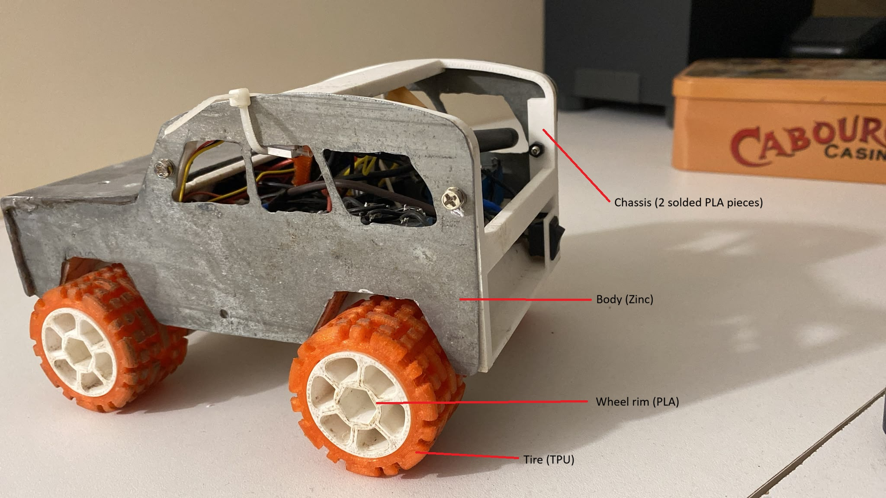

# Portfolio — Yann Royer

Site statique qui présente mes projets de robotique et de prototypage : projets personnels (RC Car, GoRider, Lap Timer, Alarm Clock Enhancer) et projets d'école.

Pas de framework ni d'étape de build : du HTML, du CSS et du JavaScript natif. Le site existe en trois langues (anglais, français, allemand).

---

## Sommaire

1. [Lancer le site](#lancer-le-site)
2. [Arborescence](#arborescence)
3. [Les pages](#les-pages)
4. [Traductions (i18n)](#traductions-i18n)
5. [Fonctionnalités JavaScript](#fonctionnalités-javascript)
6. [Styles](#styles)
7. [Ajouter un projet](#ajouter-un-projet)
8. [Cache des fichiers CSS/JS](#cache-des-fichiers-cssjs)
9. [Mise en ligne](#mise-en-ligne)
10. [Points à surveiller](#points-à-surveiller)

---

## Lancer le site

Il suffit d'ouvrir `index.html` dans un navigateur. Pour un comportement plus proche de la production (vidéos, iframes YouTube), mieux vaut passer par un petit serveur local :

```bash
python -m http.server 8000
```

Puis ouvrir <http://localhost:8000>.

---

## Arborescence

```
Portfolio/
├── index.html          Accueil : présentation, accès aux projets, à propos, contact
├── personal.html       Projets personnels : grille de cartes, une par projet
├── rc-car.html         ┐
├── gorider.html        │ Une page par projet (présentation, sections de texte,
├── lap-timer.html      │ photos légendées, liens projet précédent / suivant)
├── alarm.html          ┘
├── school.html         Projets d'école, regroupés par cours (construit par skills.js)
├── flyforce.html       Projet d'école : capteur de force FlyForce (Conception de mécanismes II)
├── vacuum-robot.html   Projet d'école : robot aspirateur en assembleur AVR (Microcontrôleurs)
├── forest-winch.html   Projet d'école : treuil de forêt (Construction mécanique II)
├── fpga-alarm-clock.html Projet d'école : réveil sur FPGA (Systèmes logiques)
├── robotic-materials.html Projet d'école : coloscope robotique souple (Robotic Materials, ETH), en cours
├── project.html        Page de détail générique des petits projets d'école (?p=<id>), remplie par skills.js
├── skills.html         Une compétence et tous les projets qui l'utilisent (?s=<id>)
├── css/
│   └── styles.css      Tout le style du site
├── js/
│   ├── i18n.js         Textes du site en EN / FR / DE
│   ├── skills.js       Registre des compétences et des projets (index + skills.html)
│   └── main.js         Comportements : langue, menu, lightbox
├── assets/
│   ├── img/            Photos, un dossier par projet
│   │   ├── home/         Couvertures des deux catégories (c1, c2)
│   │   ├── rc-car/
│   │   ├── gorider/
│   │   ├── lap-timer/
│   │   ├── alarm/
│   │   ├── creasoft/     (pas encore utilisé)
│   │   ├── logos/        ETH (ethz.ch), EPFL, ETH Robotics Club (ethrobotics.ch), EPFL Racing Team (epflracingteam.ch)
│   │   └── profile.jpg   Portrait de la page d'accueil
│   └── video/          rc-car.mp4, alarm.mp4
└── layouts/            Maquettes de référence (pas chargées par le site)
```

---

## Les pages

### `index.html` — Accueil

| Section       | Ancre       | Contenu                                                      |
|---------------|-------------|--------------------------------------------------------------|
| Hero          | `#haut`     | Titre, accroche, compétences, portrait                       |
| Logos         | (sous le hero) | Bandeau « Écoles et équipes » : ETH, EPFL, ETHRC, EPFL Racing Team, en couleurs |
| Projets       | `#projets`  | Deux panneaux cliquables : **Personnel** → `personal.html`, **École** → `school.html` |
| Compétences   | `#competences` | Index des compétences par domaine, avec le nombre de projets ; chaque ligne mène à `skills.html?s=<id>` |
| À propos      | `#apropos`  | Présentation et liste des compétences « sur l'établi »       |
| Contact       | `#contact`  | E-mail et LinkedIn                                           |

### `personal.html` — Projets personnels

Une grille de cartes (`ul.project-grid > li > a.project-card`). Chaque carte affiche une photo, le nom du projet, une phrase de résumé (clé `*.summary`) et mène à la page du projet.

### Pages de projet

| Page             | Média en tête              | Sections de texte                            | Groupes de photos                     |
|------------------|----------------------------|----------------------------------------------|---------------------------------------|
| `rc-car.html`    | Vidéo `rc-car.mp4`         | Contraintes, Les moteurs, Électronique       | La voiture, Essais de transmission    |
| `gorider.html`   | Photo `grass-left.jpg`     | Le problème (+ vidéo YouTube MXGP), L'appareil | Composants, Test d'étanchéité       |
| `lap-timer.html` | Photo `sensors.jpg`        | Version finale, Preuve de concept            | Version finale, Preuve de concept     |
| `alarm.html`     | Vidéo `alarm.mp4`          | L'idée, Comment ça marche                    | Photos                                |

Toutes suivent la même structure :

1. `header.case-hero` : lien de retour, nom, résumé, tags, fiche projet (`dl.facts` : année, durée, équipe, statut, CAO, électronique), et le média principal à droite (en dessous sur mobile).
2. `div.case-body` : sections `h2` + paragraphes, dans une colonne étroite (46rem) pour faciliter la lecture.
3. `div.case-photos` : groupes `section.photo-group` avec un titre, une intro facultative et une grille de `figure.photo`. Chaque photo a sa légende visible en dessous, et s'ouvre en grand au clic.
4. `nav.case-nav` : liens vers le projet précédent et le suivant.

Les photos ne sont jamais recadrées (`object-fit: contain`), pour que les annotations dessinées dessus restent visibles.

Les anciens liens du type `personal.html#gorider` redirigent automatiquement vers `gorider.html`.

### `skills.html` — Une compétence

`skills.html?s=arduino` affiche le nom de la compétence, les cartes de tous les projets (perso et école) qui l'utilisent, puis l'index des autres compétences. Sans paramètre (ou avec un id inconnu), la page montre seulement l'index. Tout est construit par `js/skills.js` à partir de deux listes : `portfolioSkills` (id, domaine, nom) et `portfolioProjects` (page, photo, catégorie `personal`/`school`, ids des compétences utilisées). Une compétence sans aucun projet n'apparaît pas.

### `school.html` — Projets d'école

Une grille de petites cartes (image, titre, compétences), 4 par ligne sur ordinateur, groupées par cours : chaque cours prend autant de colonnes que de projets, avec un filet au-dessus et un filet vertical quand deux cours partagent une ligne. Chaque carte mène à la page du projet. Tout est généré par `js/skills.js` : la liste `portfolioCourses` donne l'ordre des cours, et chaque projet d'école de `portfolioProjects` porte `category: "school"` et `course: "<id>"`.

### Éléments communs

Les trois pages partagent le même `<head>` (polices Google Fonts : IBM Plex Sans et IBM Plex Sans Condensed ; favicon SVG « YR » intégré), le même en-tête (logo, menu, sélecteur de langue, bouton burger sur mobile), le même pied de page et un lien d'évitement « Aller au contenu » pour l'accessibilité.

Le `<body>` porte deux attributs qui indiquent quelles clés de traduction utiliser pour le titre et la description de la page :

```html
<body data-title-key="meta.title.personal" data-desc-key="meta.desc.personal">
```

---

## Traductions (i18n)

Tous les textes sont dans `js/i18n.js`, dans un objet global `translations` avec trois langues : `en`, `fr`, `de`.

```js
const translations = {
  en: { "nav.projects": "Projects", ... },
  fr: { "nav.projects": "Projets", ... },
  de: { "nav.projects": "Projekte", ... },
};
```

### Attributs HTML reconnus

| Attribut              | Effet                                                 |
|-----------------------|-------------------------------------------------------|
| `data-i18n="clé"`        | Remplace le texte de l'élément                     |
| `data-i18n-alt="clé"`    | Remplace l'attribut `alt` (images)                 |
| `data-i18n-title="clé"`  | Remplace l'attribut `title` (iframes)              |
| `data-i18n-aria="clé"`   | Remplace `aria-label`                              |
| `data-caption-key="clé"` | Légende traduite affichée dans la lightbox         |

### Fonctionnement

- La langue choisie est enregistrée dans `localStorage` (clé `lang`). Par défaut : anglais.
- Si une clé manque dans une langue, c'est le texte anglais qui s'affiche ; si elle manque aussi en anglais, c'est la clé elle-même qui apparaît (pratique pour repérer un oubli).
- Le texte écrit directement dans le HTML sert de secours si le JavaScript ne se charge pas. Mieux vaut donc l'écrire en anglais.

### Ajouter un texte

1. Mettre `data-i18n="ma.cle"` sur l'élément dans le HTML.
2. Ajouter `"ma.cle"` dans les trois blocs `en`, `fr` et `de` de `i18n.js`.

### Ajouter une langue

1. Ajouter un bloc (par ex. `es: { ... }`) dans `i18n.js`.
2. Ajouter `"es"` au tableau `supportedLangs` dans `main.js`.
3. Ajouter un bouton `<button type="button" data-lang="es" aria-pressed="false">ES</button>` dans le `.lang-switch` des trois pages.

---

## Fonctionnalités JavaScript

Tout se trouve dans `js/main.js`, qui doit être chargé **après** `i18n.js`.

### Changement de langue — `applyLanguage(lang)`
Parcourt tous les éléments qui portent un attribut `data-i18n*`, met à jour `<html lang>`, le titre de l'onglet, la meta description et l'état `aria-pressed` des boutons de langue. Si la lightbox est ouverte, sa légende est traduite aussi.

### En-tête qui se masque — `initAutoHeader()`
- Ajoute la classe `is-scrolled` dès qu'on descend de quelques pixels.
- Masque l'en-tête (`is-hidden`) quand on descend et le réaffiche quand on remonte.
- Il reste toujours visible en haut de page, quand le menu mobile est ouvert, quand la lightbox est ouverte ou quand un élément de l'en-tête reçoit le focus clavier.

### Menu mobile
Le bouton `.nav-toggle` ouvre ou ferme `.nav` (classe `is-open`) et met à jour `aria-expanded`. Cliquer sur un lien referme le menu.

### Lightbox
Chaque photo cliquable est un bouton :

```html
<button type="button" class="shot"
        data-full="assets/img/rc-car/side.jpg"
        data-caption-key="rc.cap.side"
        data-caption="Texte de secours"
        aria-label="Enlarge RC Car side view">
  
</button>
```

Au clic, l'image `data-full` s'ouvre dans la `<dialog>`. On ferme avec la croix, la touche Échap ou un clic à côté de l'image.

### Retour en haut
Les liens `href="#haut"` remontent en douceur, ou instantanément si le système demande de réduire les animations.

### Redirection des anciens liens
Sur `personal.html`, une ancre qui correspond à un projet (`#rc-car`, `#gorider`, `#lap-timer`, `#alarm`) redirige vers la page de ce projet.

---

## Styles

`css/styles.css` commence par des variables CSS dans `:root` :

| Variable                  | Rôle                                   |
|---------------------------|----------------------------------------|
| `--sheet`, `--sheet-alt`, `--paper` | Fonds (feuille de plan, blanc froid) |
| `--ink`, `--muted`, `--line`  | Texte, texte secondaire, bordures  |
| `--blue`, `--blue-deep`   | Couleur principale (bleu du PLA)       |
| `--leader`                | Rouge des lignes de repère (légendes)  |
| `--sans`, `--narrow`      | IBM Plex Sans (texte), IBM Plex Sans Condensed (titres) |
| `--wrap`                  | Largeur max du contenu (1120 px)       |
| `--header`                | Hauteur de l'en-tête (64 px)           |

Points de rupture responsive : **980 px** (tablette) et **640 px** (mobile). Des règles `prefers-reduced-motion` désactivent les animations pour celles et ceux qui le demandent.

---

## Ajouter un projet

### Projet personnel

1. Créer `assets/img/<mon-projet>/` et y mettre les photos (et la vidéo éventuelle dans `assets/video/`).
2. Copier une page de projet existante (par ex. `lap-timer.html`) sous le nom `<mon-projet>.html`.
3. Changer le `<title>`, les attributs `data-title-key` / `data-desc-key` du `<body>`, le nom, le résumé, les tags, le média en tête, les sections et les photos.
4. Mettre à jour les liens « projet précédent / suivant » de la nouvelle page et de ses voisines.
5. Ajouter une carte dans la grille de `personal.html`.
6. Ajouter une entrée dans `portfolioProjects` (`js/skills.js`) avec la liste des compétences utilisées. Pour une nouvelle compétence : une ligne dans `portfolioSkills` et sa clé `skillname.*` dans les trois langues.
7. Ajouter toutes les nouvelles clés dans les trois langues de `i18n.js` (`meta.title.*`, `*.summary`, titres de sections, textes, légendes).

### Projet d'école

1. Copier `flyforce.html` (lien retour vers `school.html`, fiche Cours / École / Équipe / Statut). Garder `<nav class="case-nav" data-case-nav="<id>">` vide : les liens précédent / suivant sont générés par `skills.js` dans l'ordre de `school.html`.
2. Si le cours est nouveau : l'ajouter dans `portfolioCourses` (`js/skills.js`) et sa clé `course.*` dans `i18n.js`. `termKey` (semestre, clé `term.*`) est facultatif.
3. Petit projet sans page dédiée : ne pas créer de HTML, mais donner au projet un bloc `detail` (équipe, texte, légende, lien) ; il s'affiche via `project.html?p=<id>`.
4. Ajouter le projet dans `portfolioProjects` avec `category: "school"`, `course` et ses compétences (`title` pour un nom propre, ou `titleKey` si le nom se traduit). `statusKey` (facultatif, ex. `pdm.wip`) ajoute « En cours de développement » sur la carte.
5. Pour faire passer un projet à « Terminé » : retirer son `statusKey` dans `portfolioProjects`. Il apparaît alors sur `school.html` et dans les pages de compétences, sans autre modification.

---

## Cache des fichiers CSS/JS

Les fichiers sont appelés avec un numéro de version (`styles.css?v=25`, `main.js?v=24`…) pour forcer le navigateur à récupérer la nouvelle version après une modification. **Après chaque changement d'un fichier CSS ou JS, augmenter son numéro dans toutes les pages HTML** (accueil, école, compétences, grille et les pages de projet).

---

## Mise en ligne

Le site est 100 % statique, n'importe quel hébergeur gratuit convient : GitHub Pages, Netlify, Vercel, Cloudflare Pages… On envoie le dossier tel quel, `index.html` à la racine.

Avant de publier, penser à :
- compresser les photos (le format WebP ou une largeur max d'environ 1600 px allège beaucoup la page) ;
- vérifier la taille des vidéos dans `assets/video/`.

---

## Points à surveiller

Remarques relevées en lisant le code :

- **Fichiers non utilisés** : `assets/img/creasoft/` et `layouts/` ne sont référencés nulle part. Si ce sont des projets ou des maquettes à venir, aucun problème ; sinon on peut les sortir du dossier publié.
- **Clés de traduction inutilisées** : `i18n.js` contient encore d'anciennes clés qui ne sont affichées nulle part (`gorider.intro`, `gorider.p1`, `rc.spec.*`, etc.). Elles ne gênent pas, mais on peut les supprimer.

---

## Contact

- E-mail : [royer.yann+contact@free.fr](mailto:royer.yann+contact@free.fr)
- LinkedIn : [yann-miguel-royer](https://www.linkedin.com/in/yann-miguel-royer/)
